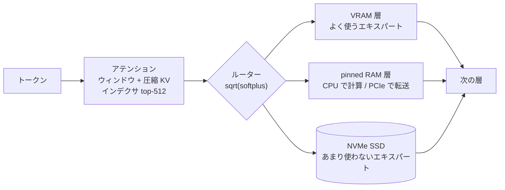

<div align="center">

# Abyss

**284B の MoE モデル DeepSeek V4 Flash を、家庭用の GPU 1 枚で動かす。**

[](LICENSE)


[English](README.md) · **日本語**

[クイックスタート](#-クイックスタート) · [性能](#-性能) · [しくみ](#-しくみ) ·
[マニュアル](docs/MANUAL.ja.md) · [クレジット](#-クレジット)

</div>

---

Abyss は [DeepSeek-V4-Flash](https://huggingface.co/deepseek-ai/DeepSeek-V4-Flash-0731) を GGUF から NVIDIA の GPU 1 枚で
動かす。よく使うエキスパートを VRAM に、次に使うものを pinned RAM に、残りを NVMe SSD に置き、会話に合わせて入れ替える。
ブラウザのチャットと、OpenAI / Anthropic 互換の API（思考とツール呼び出しに対応）が、すべて手元のマシンだけで動く。

> [!NOTE]
> Abyss は [Project Maya](https://github.com/mw00/project-maya) をコピーして作ったフォークで、Maya は
> [Strata](https://github.com/Niko1221/Strata) から生まれたプロジェクト。Maya のエンジンに DeepSeek V4 への対応を足した。
> [クレジット](#-クレジット)を参照。

## ✨ 特長

- **284B の MoE を GPU 1 枚で** — 層ごとに 256 個あるエキスパートを VRAM・pinned RAM・SSD に分けて置く。どれを先に載せるかは使い方から学ぶ
- **生成は llama.cpp の 5〜10 倍**（同じ GGUF・同じマシン）。長い prompt はまとめ処理で約 600 tok/s
- **llama.cpp と照合済み** — 3,000 トークンで次トークンの的中率が同じ（KL 0.009）
- **DeepSeek V4 のアテンションを全部実装** — スライディングウィンドウ、CSA/HCA 圧縮 KV、インデクサの top-512、sinks
- **思考とツール呼び出し** — 思考レベル `none` / `low` / `high` / `max`、DeepSeek の DSML 形式のツール呼び出し（同時呼び出しも可）
- **OpenAI / Anthropic 互換 API** と、エキスパートの配置をリアルタイムで見られるブラウザのダッシュボード
- **コマンド 1 つでセットアップ** — エンジン、モデル、pack、設定、運用スクリプトの `Abyss-tools` まで

## 📊 性能

unsloth の [DeepSeek-V4-Flash-0731-GGUF](https://huggingface.co/unsloth/DeepSeek-V4-Flash-0731-GGUF) `UD-Q2_K_XL`
（96.8 GB）、RTX 5090（32 GB）+ RAM 94 GB、Linux:

| | Abyss | llama.cpp（エキスパートは CPU） |
| --- | :---: | :---: |
| 生成 | **36〜62 tok/s** | 5〜7 tok/s |
| prompt（5.6K トークン） | **約 600 tok/s** | – |
| 起動（重み + エキスパートの読み込み） | 約 1 分 | 約 50 秒 |

エキスパート 11,008 個がすべて VRAM（23 GB）+ pinned RAM（70 GB）に収まる。読み込み後は SSD を読まない。

## 🚀 クイックスタート

```sh
git clone https://github.com/zephel01/Abyss.git ~/llm/apps/Abyss
cd ~/llm/apps/Abyss
./setup-deepseek.sh --download-model     # エンジン、モデル（96.8 GB）、pack、設定、../Abyss-tools
../Abyss-tools/abyss.sh start            # → http://127.0.0.1:8082/
```

API で試す:

```sh
curl http://127.0.0.1:8082/v1/chat/completions -H 'Content-Type: application/json' \
  -d '{"messages":[{"role":"user","content":"日本の首都はどこですか？"}],"max_tokens":4000}'
```

<details>
<summary><b>セットアップがやること</b></summary>

1. PC の確認（NVIDIA GPU、RAM）
2. Python パッケージを `.venv` に入れ、固定コミットの llama.cpp のソースを取る
3. GPU に合わせてエンジンをビルド（RTX 50 は `120a`）
4. モデルを `../Abyss-data` にダウンロード（`--download-model` がなければ先に確認）し、全ファイルの SHA-256 を照合
5. シャードと同じフォルダに pack を作る
6. `abyss-<名前>.json` と `run-abyss-<名前>.sh` を書く
7. `../Abyss-tools` を作る — `abyss.sh start | stop | restart | status | update | build | log | models`

済んだ手順は飛ばすので、何度実行してもよい。オプション（`--quant`、`--context`、`--port`、`--tools-only` など）は
[マニュアル](docs/MANUAL.ja.md#まとめてセットアップ)。

</details>

### 必要なもの

| | |
| --- | --- |
| OS | Linux（Ubuntu で確認） |
| GPU | NVIDIA。確認したのは RTX 5090 32 GB |
| メモリ | 全エキスパートをメモリに置くには VRAM + RAM が約 100 GB 以上（少なくても SSD から読んで動く） |
| ディスク | 空き約 100 GB の NVMe SSD |
| ツール | CUDA 13.x（`nvcc`）、g++、Python 3.10 以上 |

## 🧠 しくみ



各層のアテンションは GPU で計算し、ルーターが 256 個から 6 個のエキスパートを選ぶ。VRAM にあるものはそのまま計算し、
RAM 層のものは CPU で計算するか PCIe で GPU に送る（配分は起動時に測って決める）。残りは SSD から読み、使われるほど上の層に
上がる。長い prompt はエキスパートの行列積（MMQ）を使うまとめ処理で読む。
詳しくは [docs/deepseek4/PORT.md](docs/deepseek4/PORT.md)、計算の仕様は [docs/deepseek4/SPEC.md](docs/deepseek4/SPEC.md)。

## ✅ 正しさの確認

同じ GGUF で、llama.cpp の logits と比べた（`tools/dsv4_logits_dump.cpp`）:

| テスト | 結果 |
| --- | --- |
| 3,000 トークンの文書 | KL 0.009 · top-1 一致 94.5% · 次トークン的中率 60.35%（llama.cpp も 60.35%）· 位置が進んでもずれは増えない |
| まとめ処理で 2,499 トークン → 500 トークン | KL 0.006 · top-1 一致 95.2% |
| トークナイザー（`joyai-llm`） | `llama-tokenize` と同じ ID |

## 📚 ドキュメント

| | |
| --- | --- |
| [マニュアル](docs/MANUAL.ja.md) · [Manual](docs/MANUAL.md) | セットアップ、設定、API、設定項目、トラブル対応 |
| [移植の記録](docs/deepseek4/PORT.md) | Abyss が足したものと、その確認方法 |
| [仕様](docs/deepseek4/SPEC.md) | 実装した DeepSeek V4 の計算 |
| [Maya のドキュメント](docs/maya/README.md) | Maya の文書をそのまま残したもの: GLM-5.3-Flash、インストーラ（`./abyss.sh`）、チューニング、AMD、複数 GPU |

## 🗺️ ロードマップ

- [x] DeepSeek V4 Flash: 1 トークンずつの処理、まとめ処理、会話の再利用
- [x] 思考レベル、DSML のツール呼び出し、OpenAI / Anthropic 互換 API
- [x] コマンド 1 つのセットアップと `Abyss-tools`
- [ ] 投機デコード（DSpark のドラフトモデル。この GGUF には MTP ブロックがない）
- [ ] 会話のディスク保存
- [ ] DeepSeek V4 での Windows と複数 GPU（確認したのは Linux の GPU 1 枚）
- [ ] まとめ処理の調整（長い prompt では RAM 層のエキスパートを GPU に送る時間が大半）

## 🙏 クレジット

Abyss は **[Project Maya](https://github.com/mw00/project-maya)**（MIT、mw00 とコントリビューター）をコピーして作った
フォークで、Maya は **[Strata](https://github.com/Niko1221/Strata)**（MIT、Niko1221 と Strata のコントリビューター）から
生まれた。Maya の GLM-5.3-Flash の実行部、エキスパートの配置、まとめ処理、サーバー、ダッシュボードはそのまま使い、そこに
DeepSeek V4（llama.cpp の `deepseek4` アーキテクチャ）を GLM-5.3-Flash と並べて足した。Maya の README と文書は
[docs/maya/](docs/maya/README.md) に残している。DeepSeek V4 の計算は [llama.cpp](https://github.com/ggml-org/llama.cpp) の
実装に、量子化モデルは [unsloth](https://huggingface.co/unsloth) のものに拠っている。すべてに感謝する。

## 📄 ライセンス

Maya・Strata と同じく MIT — [LICENSE](LICENSE)。モデルの重みはそれぞれのライセンスに従う（DeepSeek V4: MIT）。
