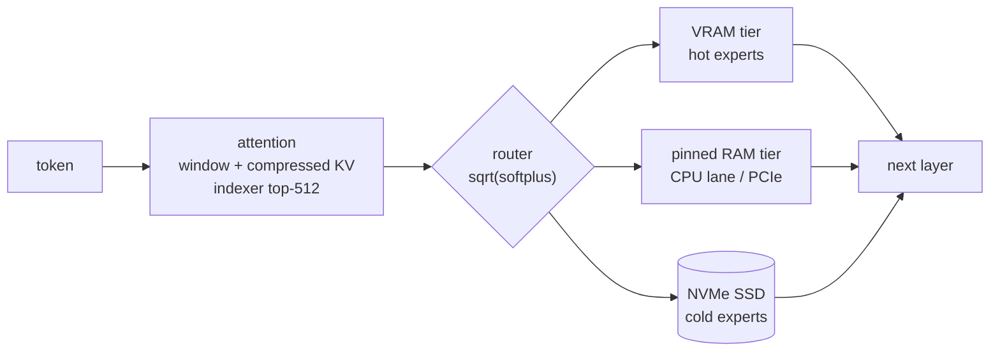

<div align="center">

# Abyss

**Run DeepSeek V4 Flash — a 284B mixture-of-experts model — on a single consumer GPU.**

[](LICENSE)


**English** · [日本語](README.ja.md)

[Quick start](#-quick-start) · [Performance](#-performance) · [How it works](#-how-it-works) ·
[Manual](docs/MANUAL.md) · [Credits](#-credits)

</div>

---

Abyss runs [DeepSeek-V4-Flash](https://huggingface.co/deepseek-ai/DeepSeek-V4-Flash-0731) from a GGUF on one NVIDIA
GPU. The engine keeps the most-used experts in VRAM, the next ones in pinned RAM and the rest on the NVMe SSD, and
moves them as the conversation needs them. You get a browser chat and OpenAI- / Anthropic-compatible APIs, with
thinking and tool calls — all on your own machine.

> [!NOTE]
> Abyss is a fork of [Project Maya](https://github.com/mw00/project-maya), which grew out of
> [Strata](https://github.com/Niko1221/Strata). It adds DeepSeek V4 to Maya's engine. See [Credits](#-credits).

## ✨ Highlights

- **284B MoE on one card** — 256 experts per layer spread over VRAM, pinned RAM and SSD, filled from your own usage.
- **5–10x llama.cpp's decode speed** on the same GGUF and machine, with the batched prompt path at ~1,000-1,700 tok/s.
- **An AMD APU's integrated GPU as a second lane** — on a Ryzen AI Max the Radeon iGPU computes the RAM-tier experts in place (ROCm; picked at start when it is faster than the CPU).
- **Checked against llama.cpp** — same next-token accuracy over 3,000 tokens (KL 0.009).
- **Full DeepSeek V4 attention** — sliding window, CSA/HCA compressed KV, the lightning indexer's top-512, sinks.
- **Thinking and tool calls** — reasoning levels `none` / `low` / `high` / `max`, DeepSeek's DSML tool calls, parallel calls.
- **OpenAI and Anthropic APIs** plus a browser dashboard with a live view of the expert tiers.
- **One-command setup** — engine, model, pack, config and the `Abyss-tools` helper scripts.

## 📊 Performance

unsloth's [DeepSeek-V4-Flash-0731-GGUF](https://huggingface.co/unsloth/DeepSeek-V4-Flash-0731-GGUF) `UD-Q2_K_XL`
(96.8 GB), RTX 5090 (32 GB) + Ryzen AI Max+ 395 with 94 GB RAM (iGPU lane on), Linux:

| | Abyss | llama.cpp (experts on the CPU) |
| --- | :---: | :---: |
| Decode (answers of ~1,500 tokens) | **~73 tok/s** (CPU lane only: ~56) | 5–7 tok/s |
| Decode (coding prompts, up to 800 tokens) | **~66 tok/s**, ~78 with `STRATA_DS4_SPEC=1` | 5–7 tok/s |
| Prompt (5.6K tokens) | **~1,000–1,090 tok/s** | – |
| Prompt (18K tokens) | **~1,700 tok/s** | – |
| Start-up (weights + expert warm-up) | ~1 min | ~50 s |

All 11,008 routed experts fit in VRAM (23 GB) + pinned RAM (70 GB) — nothing is read from the SSD once warm.

## 🚀 Quick start

```sh
git clone https://github.com/zephel01/Abyss.git ~/llm/apps/Abyss
cd ~/llm/apps/Abyss
./setup-deepseek.sh --download-model     # engine, model (96.8 GB), pack, config, ../Abyss-tools
../Abyss-tools/abyss.sh start            # → http://127.0.0.1:8082/
```

Then talk to it:

```sh
curl http://127.0.0.1:8082/v1/chat/completions -H 'Content-Type: application/json' \
  -d '{"messages":[{"role":"user","content":"What is 17*23?"}],"max_tokens":4000}'
```

<details>
<summary><b>What the setup does</b></summary>

1. checks the PC (NVIDIA GPU, RAM)
2. installs the Python packages into `.venv` and fetches llama.cpp's source at the pinned commit
3. compiles the engine for your GPU (`120a` on RTX 50)
4. downloads the model to `../Abyss-data` (asks first without `--download-model`) and checks every SHA-256
5. builds the pack next to the shards
6. writes `abyss-<name>.json` and `run-abyss-<name>.sh`
7. creates `../Abyss-tools` — `abyss.sh start | stop | restart | status | update | build | log | models`

Every step is skipped when done, so it is safe to run again. Options: `--quant`, `--context`, `--port`, `--tools-only`,
and more in the [manual](docs/MANUAL.md#setup-in-one-command).

</details>

### Requirements

| | |
| --- | --- |
| OS | Linux (tested on Ubuntu) |
| GPU | NVIDIA, tested on RTX 5090 32 GB |
| Memory | VRAM + RAM ≳ 100 GB to keep every expert in memory (less works, reading from the SSD) |
| Disk | NVMe SSD with ~100 GB free |
| Toolchain | CUDA 13.x (`nvcc`), g++, Python 3.10+; optional ROCm 7 (`hipcc`) for the iGPU lane on an AMD APU |

## 🧠 How it works



Each layer's attention runs on the GPU; its router picks 6 of 256 experts. Experts in VRAM run in place, RAM-tier ones
are either computed by the CPU or copied over PCIe (the split is measured at start), and the rest are read from the
SSD and promoted as you use them. Long prompts go through a batched path with expert GEMMs (MMQ).
Details: [docs/deepseek4/PORT.md](docs/deepseek4/PORT.md), the forward pass: [docs/deepseek4/SPEC.md](docs/deepseek4/SPEC.md).

## ✅ Correctness

Teacher-forced logits against llama.cpp on the same GGUF (`tools/dsv4_logits_dump.cpp`):

| Test | Result |
| --- | --- |
| 3,000-token document | KL 0.009 · same top token 94.5% · next-token accuracy 60.35% (llama.cpp: 60.35%) · no drift with position |
| Batched prompt (2,499 tokens) then 500 tokens | KL 0.006 · same top token 95.2% |
| Tokenizer (`joyai-llm`) | identical ids to `llama-tokenize` |

## 📚 Documentation

| | |
| --- | --- |
| [Manual](docs/MANUAL.md) · [マニュアル](docs/MANUAL.ja.md) | setup, configuration, API, settings, troubleshooting |
| [Port notes](docs/deepseek4/PORT.md) | what Abyss adds and how it was validated |
| [Spec](docs/deepseek4/SPEC.md) | DeepSeek V4's forward pass as implemented |
| [Maya docs](docs/maya/README.md) | Maya's documentation, unchanged: GLM-5.3-Flash, its installer (`./abyss.sh`), tuning, AMD, multi-GPU |

## 🗺️ Roadmap

- [x] DeepSeek V4 Flash: token path, batched prompt path, conversation reuse
- [x] Thinking levels, DSML tool calls, OpenAI / Anthropic APIs
- [x] One-command setup with `Abyss-tools`
- [ ] Speculative decoding (DSpark drafter; this GGUF has no MTP block)
- [ ] Conversation slots on disk
- [ ] Windows for DeepSeek V4 (Linux tested)
- [ ] Multi-GPU for DeepSeek V4: the layer split runs (RTX 5090 + RTX 3090 measured); V100 builds with CUDA 12 (not
  yet run on one)
- [ ] AMD (HIP): runs on the Radeon 8060S with WMMA indexer kernels (`--backend hip`); discrete Radeon cards and the
  prompt attention's WMMA kernel still to come
- [ ] Prompt-path tuning (staging RAM-tier experts dominates long prompts)

## 🙏 Credits

Abyss is a copy (fork) of **[Project Maya](https://github.com/mw00/project-maya)** (MIT, by mw00 and contributors),
which grew out of **[Strata](https://github.com/Niko1221/Strata)** (MIT, by Niko1221 and the Strata contributors).
Maya's GLM-5.3-Flash runner, expert tiers, prompt path, server and dashboard are kept as they are; DeepSeek V4
(llama.cpp's `deepseek4` architecture) is added next to GLM-5.3-Flash. Maya's own README and documentation are kept in
[docs/maya/](docs/maya/README.md). The DeepSeek V4 math follows [llama.cpp](https://github.com/ggml-org/llama.cpp)'s
implementation, and the quantized model is [unsloth](https://huggingface.co/unsloth)'s. Thanks to all of them.

## 📄 License

MIT, as Maya and Strata — see [LICENSE](LICENSE). Model weights are under their own licenses (DeepSeek V4: MIT).
